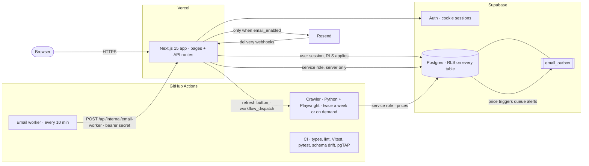

# PriceTracker

[](https://github.com/28CN/PriceTracker/actions/workflows/ci.yml)
[](https://github.com/28CN/PriceTracker/actions/workflows/crawl-prices.yml)
[](https://github.com/28CN/PriceTracker/actions/workflows/send-emails.yml)


A small price matrix for Australian shops. You save a product once, paste the links
for each shop that stocks it, and a scheduled crawler fills in the prices. The site
shows the cheapest shop up front and the full list when you tap a product.

<!-- PLACEHOLDER:SCREENSHOTS (frontend agent) -->
<!-- Replace this block with 2–3 screenshots and one short GIF, e.g.
     
     
     
     Use the demo account only. No real user data in images. -->
> 📸 _Screenshots and a GIF are coming soon._
<!-- /PLACEHOLDER:SCREENSHOTS -->

## Try the demo

<!-- PLACEHOLDER:TRY-THE-DEMO (frontend agent) -->
<!-- Fill in: the demo URL, what the visitor can do (read-only), and that the
     demo account resets on every sign-in. Do not put any password here. -->
> 🧪 _Demo details are coming soon._
<!-- /PLACEHOLDER:TRY-THE-DEMO -->

## Architecture



- **Next.js on Vercel** serves the pages and API routes. Reads go through the
  signed-in user's Supabase session, so Postgres row-level security decides what
  they see. Only a few server-only routes use the service-role key.
- **Supabase** holds accounts, products, links and price history. Price inserts
  fire triggers that update alert state and queue emails in a transactional outbox.
- **GitHub Actions** runs the crawler on a schedule (or when someone presses
  refresh). It also runs the email worker, which asks the app to drain the outbox.
- **Resend** sends mail, but only when the `email_enabled` flag is on.

## Technical highlights

- **Row-level security everywhere.** Every `public` table has RLS on, and policies
  are written per owner. Public watchlists are read-only for everyone else. CI
  checks this with pgTAP (`supabase/tests/`).
- **Security-definer lockdown.** Definer functions run with `search_path = ''`.
  `EXECUTE` is revoked from `PUBLIC`, `anon` and `authenticated` unless a function
  is meant to be called by users. A pgTAP test fails if any definer function in
  `public` is executable by `PUBLIC`. A snapshot of function privileges is
  diffed in CI.
- **A read-only demo account.** Restrictive RLS policies block every write by the
  demo user, and a trigger stops it clearing its own demo flag. The `/demo` route
  resets the demo password through the admin API *before* signing in. If the reset
  fails, login is refused rather than falling back to an old password.
- **Email feature flag.** `app_settings.email_enabled` (default off) is checked by
  a `BEFORE INSERT` trigger on `email_outbox`. With it off, alert state still
  advances but no mail is queued. The app routes return a clear 503 for flows that
  need email. See [`docs/EMAIL.md`](docs/EMAIL.md).
- **Price insight** (in review, PR #12). A `security_invoker` stats view gives
  30/90-day low/avg/high per link. A pure TypeScript verdict reports
  `real_discount`, `fake_discount` (raised shortly before the "sale") or
  `insufficient_data`. It compares against daily-sampled medians.
- **Layered CI** ([`ci.yml`](.github/workflows/ci.yml)):
  1. TypeScript `tsc`, ESLint, Vitest unit and route tests, `next build` (Node 22)
  2. pytest for the crawler's parsing helpers (Python 3.11)
  3. A local Postgres from `supabase db start`. CI re-applies every migration to
     prove they are idempotent, and diffs columns, policies, indexes and function
     privileges against a snapshot of production. Then pgTAP tests run, rolled back.
- **SSRF-safe fetching.** Server-side fetches of user-supplied URLs resolve DNS
  first and refuse private and reserved addresses (`src/lib/net/safeFetch.ts`).

## Design tradeoffs

- **GitHub Actions instead of a queue or cron service.** It is free and simple, and
  it has logs and artifacts for crawler diagnostics. The cost is latency: crawls
  take minutes to start, and the email worker polls every 10 minutes rather than
  sending instantly. An "after()" send-immediately variant exists on the
  `email-send-immediately` branch but is not merged.
- **Transactional outbox in Postgres.** Emails are queued by the same triggers that
  update alert state, so an alert is never lost or sent twice (dedupe keys). The
  cost is one more table and a worker to drain it.
- **The flag sits in the database, not an env var.** Turning email on or off needs
  no redeploy, and the trigger enforces it even for code paths that forget to
  check. The cost is that switching it is a SQL change, not a dashboard toggle.
- **RLS as the authority.** API routes use the user's session client, so a bug in a
  route cannot leak another user's rows. The cost is that policies and definer
  functions need careful review, which is why pgTAP and privilege snapshots run in CI.
- **pgTAP on `supabase db start`, not the full stack.** CI only starts Postgres,
  which is enough for RLS and trigger tests and is quicker than `supabase start`.
  The tradeoff is that the tests run against migrations on an empty database, not
  production data.
- **Bot-walled shops are crawled from a desktop PC.** Some retailers block cloud
  and headless browsers. They are skipped in Actions and covered by a scheduled
  local run (see below) rather than paying for proxies.
- **Plain `` for product images.** Images come from arbitrary retailer hosts,
  so `next/image` would need a remote allowlist that changes whenever a shop is added.

## Running locally

Requirements: Node 22 (`nvm use`), Docker (for the local Supabase), the Supabase
CLI, and Python 3.11+ for the crawler.

```bash
npm ci
cp .env.local.example .env.local      # fill in your own project values; never commit it

# local database built only from migrations
supabase db start
supabase test db                      # pgTAP tests (rolled back)
bash scripts/check-schema-drift.sh    # idempotency + snapshot diff

npm run dev                           # http://localhost:3000
npm run lint
npm test                              # Vitest
npx tsc --noEmit

# crawler unit tests
pip install -r crawler/requirements-dev.txt
(cd crawler && python -m pytest -q)
```

For a local database, point `NEXT_PUBLIC_SUPABASE_URL` / keys at the values printed by
`supabase status`. Email stays off unless you turn on `email_enabled` in
`app_settings` and set the Resend variables.

## Deploying your own copy

### 1. Database

For an existing installation, follow [`docs/AUTH-SETUP.md`](docs/AUTH-SETUP.md).
It covers the account/RLS migration, initial account bootstrap, Resend, deployment
secrets and first-login verification.

For a new database, apply `supabase/migrations/` in order (`supabase db push`, or
`supabase db start` locally). The migrations are the only schema source; see
[`docs/DATABASE.md`](docs/DATABASE.md).

### 2. GitHub repository secrets

`Settings` -> `Secrets and variables` -> `Actions`:

| Secret | Value |
| --- | --- |
| `SUPABASE_URL` | `https://<project>.supabase.co` |
| `SUPABASE_SERVICE_ROLE_KEY` | the secret (`sb_secret_...`) key |

### 3. Vercel environment variables

| Variable | Value |
| --- | --- |
| `NEXT_PUBLIC_SUPABASE_URL` | `https://<project>.supabase.co` |
| `NEXT_PUBLIC_SUPABASE_ANON_KEY` | the publishable (`sb_publishable_...`) key |
| `SUPABASE_SERVICE_ROLE_KEY` | the secret key, used by the write routes |
| `GITHUB_TOKEN` | fine-grained token limited to this repo, Actions read/write only (see `docs/GITHUB-TOKEN.md`) |
| `GITHUB_OWNER` | your GitHub username |
| `GITHUB_REPO` | the repository name |
| `GITHUB_WORKFLOW_ID` | `crawl-prices.yml` |
| `GITHUB_REF` | `main` |
| `NEXT_PUBLIC_SITE_URL` | the public site URL without a trailing slash, e.g. `https://pricetracker-au.vercel.app` |

All absolute links (email verification, unsubscribe) are built from `NEXT_PUBLIC_SITE_URL` via `src/lib/siteUrl.ts`. GitHub Actions uses the repository variable `SITE_URL` for the same value.

Redeploy after adding them so the new values are picked up.

## Using the site

- **Home** lists every tracked product with its cheapest current price and the shop
  that has it. Tap a product to see all shops. Pin a category to keep it at the top
  and expanded. Products currently at or under their target price sort first.
- **Manage** is where you create a category, add a product, and paste up to five shop
  links. The shop name is filled in from the URL. You can come back later to add more
  links, pause one, or delete it.
- A tiny **pending support** label appears on shops the crawler does not have a
  dedicated parser for yet. Unknown shops still go through JSON-LD, Shopify product
  JSON, and generic price CSS. Failures are written to
  `crawler/pending-retailers.json` so the next code update can add them.
- The **flag button** in the top right collects crawler notices, such as a link that
  has gone dead or a page where no price could be found.
- The **refresh button** next to it queues an immediate crawl through GitHub Actions.
  Give it a couple of minutes, then reload.

## Running the crawler locally

```bash
pip install -r crawler/requirements.txt
python -m playwright install chromium
python -m playwright install chrome   # important, see below
python crawler/main.py
```

Install `chrome` as well as `chromium`. Given no channel, Playwright 1.49 and newer
start `chrome-headless-shell`, an old headless build that Akamai rejects on sight;
Big W answers 403 to it and 200 to every branded build. The crawler tries
`chrome`, `msedge`, `chromium` and only then the bare shell, and prints the channel
it settled on as `[BROWSER] channel=...` on the first line of every run.

Useful environment variables:

| Variable | Effect |
| --- | --- |
| `TEST_URL` | parse one page and print the price, without touching the database |
| `CRAWL_PRODUCT_ID` | only crawl the links belonging to one product |
| `CRAWL_LINK_ID` | only crawl a single link |
| `CRAWL_RETAILERS` | only crawl matching shops (omit to crawl everything) |
| `CRAWL_SKIP_RETAILERS` | crawl everything except these shops |
| `CRAWL_BROWSER_MODE` | `cdp` (default) or `launch`, see below |
| `CRAWL_BROWSER_PATH` | use a specific Chrome or Edge binary |
| `CRAWL_BROWSER_PROFILE` | where the browser profile lives, so cookies persist |
| `CRAWL_PROXY` | send browser traffic through a proxy, e.g. `http://host:8080` |
| `CRAWL_PROXY_USERNAME` / `CRAWL_PROXY_PASSWORD` | credentials for that proxy |
| `CRAWL_SAVE_SNAPSHOTS` | set to `0` to stop writing `crawler-diagnostics/` |

When a page yields no price the crawler saves the HTML and a screenshot under
`crawler-diagnostics/`, and the workflow uploads that folder as an artifact. It is
the quickest way to tell a bot wall apart from a redesigned page.

## How the browser is driven

The crawler does not let Playwright start the browser. It starts an ordinary
Chrome or Edge itself, with a debugging port open, and drives it over CDP.

That distinction decides whether Kmart and Target answer at all. Measured against
both, on one machine, within a few minutes of each other:

| How the browser was started | Kmart / Target |
| --- | --- |
| Playwright, headless | `Access Denied` |
| Playwright, headful | `Access Denied` |
| Playwright, headful, stealth off | `Access Denied` |
| Started normally, driven over CDP, headless | `Access Denied` |
| Started normally, driven over CDP, headful | price returned |

So it needs both a real browser started the ordinary way *and* a display. There is
nothing to solve or wait out: the same page in the same browser build differs only
by how the process was started.

`CRAWL_BROWSER_MODE=cdp` is the default. If no Chrome or Edge is installed, or
there is no display, the crawler says so and falls back to letting Playwright
launch one, which still works for Coles, Woolworths, The Reject Shop, Toys R Us
and Toyworld.

Unknown specialty shops are crawled with a generic path (JSON-LD, Shopify
product JSON, then CSS). If that is not enough, the host is appended to
`crawler/pending-retailers.json` and a crawler notice is raised. Bot-walled shops
(Kmart, Target, Big W, Toymate, Bunnings, Chemist Warehouse) need this PC when
GitHub Actions cannot reach them.

## Splitting the work between machines

GitHub Actions runs under `xvfb-run` and automatically skips bot-walled shops
(unless `CRAWL_PROXY` is set). Coles, Woolworths, Repco, Supercheap Auto, Auto Barn
and other open shops stay on the cloud schedule.

This PC is the full backup: `scripts/crawl-background.ps1` (Task Scheduler
Mon + Wed) and `crawl-local.bat` crawl **every** tracked shop, including the ones
GitHub already covers. That way Wednesday always refreshes everything, and cloud
gaps do not leave Bunnings / Kmart / etc. stale.

- Easiest: double-click `crawl-local.bat` in the repo root (window stays open so you can read errors).
- Or from a terminal already in the repo:

```powershell
powershell -ExecutionPolicy Bypass -File scripts\crawl-local.ps1
```

It opens a browser window (Chrome preferred, then Edge), crawls every active link
(or only `CRAWL_RETAILERS` if you set that), and closes it again. Leave the window
alone while it runs. Register the weekly task with:

```powershell
powershell -ExecutionPolicy Bypass -File scripts\register-tasks.ps1
```

Do not use Win+R alone — that closes the window as soon as the script exits, so
errors flash past. The `.bat` file (or an already-open PowerShell / Terminal) is
the reliable way.

Hit rates drop when one address requests many pages in a row. Big W will serve a
price and then refuse for several minutes after repeated crawls, so keep the
schedule infrequent rather than retrying hard.

## Notes

- Account sessions use rotating Supabase tokens in cookies. Product writes are
  authorised again by database RLS rather than trusting the interface alone.
- Public watchlists are read-only. New accounts default to private.
- Prices are only read from structured data or price elements on the page. If a shop
  changes its layout the crawler reports it rather than guessing, so a wrong price
  never ends up in the history.
